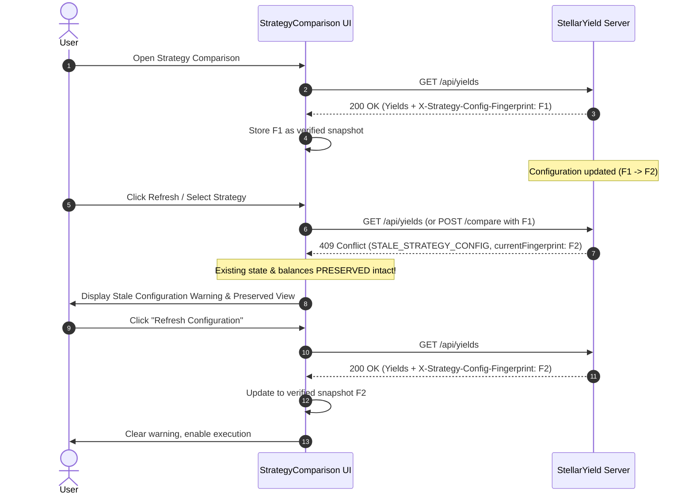

# Strategy Comparison Configuration Hardening & Snapshot Fingerprinting

Reference implementation for **Issue #1918**: Harden strategy comparison against stale configuration snapshots.

---

## 1. Overview

Strategy comparison and yield evaluation evaluate yield opportunities across supported Stellar protocols (Blend, Soroswap, DeFindex). Previously, comparison snapshots were evaluated without an immutable configuration binding, creating risks of configuration drift, stale cache poisoning, or unintended state mutations when validation or execution failed.

This hardening introduces:
1. **Deterministic, Immutable Configuration Fingerprinting**:
   A canonical, pure SHA-256 digest (`scf-...`) computed over the active comparison configuration (supported protocols, validation boundaries, schema versions, risk constraints).
2. **Stale Snapshot Rejection**:
   Server endpoints (`/api/strategies/compare`, `/api/yields`) verify the snapshot's claimed fingerprint against the active configuration. Stale snapshots are rejected with HTTP `409 STALE_STRATEGY_CONFIG`, preventing out-of-date comparisons from proceeding.
3. **State and Balance Preservation**:
   Strict failure safety guarantees ensure that application state and balances remain 100% untouched whenever boundary validation fails, configuration is stale, or downstream execution errors occur.
4. **Safe Refresh & Retry**:
   Clients can cleanly refresh the configuration snapshot and retry ongoing work without loss of user progress or balance corruption.

---

## 2. Configuration Fingerprint Specification

### 2.1 Canonical Configuration Schema

```typescript
export interface StrategyComparisonConfig {
  supportedProtocols: string[];
  validationRules: {
    requiredFields: string[];
    allowedRebalancingBehaviors: string[];
    minLiquidityUsd?: number;
  };
  schemaVersion: string;
  riskConstraints?: {
    maxRiskScore?: number;
    maxVolatilityPct?: number;
  };
}
```

### 2.2 Canonicalization & Hashing

To guarantee determinism regardless of JSON property ordering or array insertion sequence:
- Protocols, required fields, and rebalancing behaviors are sorted alphabetically.
- Numbers and versions are normalized to canonical string/number representations.
- Deterministic key-sorted JSON serialization (`stableStringify`) feeds into zero-dependency RFC 6234 / FIPS 180-4 pure SHA-256 (`sha256Pure`).

```typescript
const { fingerprint, shortFingerprint } = computeStrategyComparisonConfigFingerprint(config);
// fingerprint: "a1b2c3d4e5f6..." (64 hex characters)
// shortFingerprint: "scf-a1b2c3…d4e5"
```

---

## 3. Server Endpoints & Protocol

### 3.1 `GET /api/strategies/config-snapshot`
Returns the active configuration and its immutable SHA-256 fingerprint.

**Response `200 OK`**:
```json
{
  "config": {
    "supportedProtocols": ["Blend", "DeFindex", "Soroswap"],
    "validationRules": {
      "requiredFields": ["apy", "liquidityUsd", "protocolName", "riskScore", "tvl"],
      "allowedRebalancingBehaviors": ["Dynamic", "Static", "Yield-Weighted"],
      "minLiquidityUsd": 0
    },
    "schemaVersion": "1.0.0",
    "riskConstraints": { "maxRiskScore": 100, "maxVolatilityPct": 100 }
  },
  "configFingerprint": "...",
  "shortFingerprint": "scf-...",
  "generatedAt": "2026-11-19T20:00:00.000Z"
}
```
**Headers**:
`X-Strategy-Config-Fingerprint: <64-char-sha256>`

---

### 3.2 `POST /api/strategies/compare`
Compares strategy parameters while ensuring the caller's snapshot matches the active configuration.

**Request**:
```json
{
  "expectedConfigFingerprint": "a1b2c3d4...",
  "strategyIds": ["blend", "soroswap"]
}
```

**Responses**:
- `200 OK`: Valid snapshot, comparison results returned.
- `409 Conflict`: Snapshot is stale.
  ```json
  {
    "error": "Strategy comparison configuration snapshot is stale. Configuration must be refreshed before proceeding.",
    "code": "STALE_STRATEGY_CONFIG",
    "isRecoverable": true,
    "currentFingerprint": "...",
    "currentConfig": { ... }
  }
  ```

---

### 3.3 `GET /api/yields` Staleness Guard
- Includes response header: `X-Strategy-Config-Fingerprint: <sha256>`
- Supports query `?expectedConfigFingerprint=...` and header `if-match-config: ...`.
- If caller provides an expected fingerprint that does not match current configuration, returns `409 STALE_STRATEGY_CONFIG`.

---

## 4. State & Balance Preservation Guarantees

In accordance with Acceptance Criterion B:

| Failure Mode | Application State | Balances | User Experience |
|---|---|---|---|
| **Stale Snapshot Fingerprint** | Retained intact | 100% Unchanged | Stale warning banner shown with one-click "Refresh Configuration" action |
| **Boundary Validation Failure** | Retained intact | 100% Unchanged | Non-destructive warning banner shown; previous verified strategies remain interactive |
| **Execution Error (RPC / Relayer)** | Retained intact | 100% Unchanged | Typed error notice shown with safe retry option |
| **Verified Execution Success** | Confirmed & updated | Updated atomically | Confirmed execution status with cryptographic fingerprint badge |

---

## 5. Client Verification Workflow


